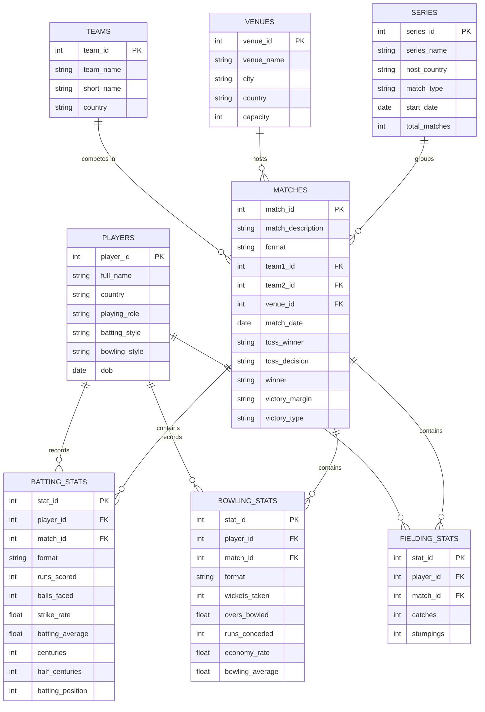

# 🏏 Cricbuzz LiveStats — Real-Time Cricket Intelligence & SQL Analytics


-003B57?logo=sqlite&logoColor=white)


---

## 🚀 Live Demo & Quick Access

**Explore the interactive multi-page web application:**

👉 **Local URL:** `http://localhost:8501`  
👉 **Cloud Deployment:** Streamlit Community Cloud / Render ready (`render.yaml` & `Dockerfile` included)

---

## 📌 Executive Overview

**Cricbuzz LiveStats** is an enterprise-grade sports intelligence and cricket analytics platform that bridges **live match feeds from the official Cricbuzz REST API** with a **relational 3NF SQL database** and a **PowerBI-inspired interactive Streamlit dashboard**.

Engineered for data analysts, fantasy sports strategists, cricket enthusiasts, and media commentators, the platform combines real-time telemetric live match monitoring with an extensive suite of **25 production-tested analytical SQL queries**, deep player profiling across all international formats (Test, ODI, T20I), full transactional CRUD capabilities, and gamified analytical controls.

> **💡 Design Philosophy:** Crafted with a high-performance **Dark Glassmorphic UI** (Cricbuzz emerald `#008767`, deep slate `#0F172A`), zero-latency Web Audio sound synthesizer feedback (`🔊 / 🔇`), sticky telemetry HUD, 6-KPI metrics ribbon, and responsive 3x2 Plotly visualization matrix.

---

## 🌟 Core Pillars & Key Features

```text
┌────────────────────────────────────────────────────────────────────────────────────────┐
│                                 CRICBUZZ LIVESTATS                                     │
├────────────────────┬────────────────────┬────────────────────┬─────────────────────────┤
│  ⚡ Live Matches   │  📊 Player Stats   │  🔍 SQL Analytics  │   🛠️ CRUD Operations    │
│  • Real-Time Feeds │  • Multi-Format    │  • 25 Questions    │   • Manage Players      │
│  • Scorecards      │  • Top 10 Bat/Bowl │  • Beginner → Adv. │   • Fixtures & Teams    │
│  • Worm & Phase    │  • Head-to-Head    │  • Window & CTEs   │   • Live Scorecards     │
│  • Mock Fallback   │  • Plotly Radars   │  • Telemetry & CSV │   • Validation Engine   │
└────────────────────┴────────────────────┴────────────────────┴─────────────────────────┘
```

### 1. ⚡ Real-Time Live Match Engine
- **Live Match Feeds:** Instant live scorecards, current overs, wickets, required/current run rates, partnership tracking, and venue conditions powered by RapidAPI Cricbuzz endpoints.
- **Resilient Offline Fallback:** Graceful auto-failover to a high-fidelity mock data provider if API limits are reached or when operating offline without internet connectivity.
- **PowerBI Match Analytics:** Over-by-over worm charts, match phase breakdowns (Powerplay, Middle, Death overs), and run contribution donuts.

### 2. 🏆 Multi-Format Player Leaderboards & Career Profiler
- **Format-Specific Analytics:** Comprehensive coverage of **Test**, **ODI**, and **T20I** cricket formats.
- **Top 10 Rankings:** Real-time filtered leaderboards for runs, batting average, strike rates, centuries, wickets taken, economy rates, and bowling strike rates.
- **Deep Career Profiler:** Select any player to reveal biographical details, career milestone cards, form radars, and cross-format performance distributions.

### 3. 🔍 25 Production-Tested SQL Analytics Suite
- **Tiered Question Catalog:** 25 structured analytical queries answering complex business and sporting scenarios:
  - **Beginner (Q1–Q8):** Filtering, multi-condition selection, aggregations, grouping, and date sorting.
  - **Intermediate (Q9–Q16):** Multi-table joins, subqueries, conditional `CASE WHEN` aggregation, century partnerships, and clutch performer metrics.
  - **Advanced (Q17–Q25):** Analytical Window Functions (`ROW_NUMBER()`, `RANK()`, `LAG()`), Common Table Expressions (CTEs), mathematical standard deviation consistency modeling, weighted composite MVP ranking algorithms, and quarterly time-series momentum tracking.
- **Interactive In-Browser Console:** View question objectives, underlying SQL logic, execution speed telemetry (milliseconds), interactive tables, and one-click CSV data export.

### 4. 🛠️ Transactional CRUD Operations Engine
- **Complete Data Lifecycle Management:** Create, Read, Update, and Delete records for **Players**, **Matches & Fixtures**, and **Match Scorecards**.
- **Domain Validation Guardrails:** Strict checks against negative runs/overs, invalid date sequences, team identity duplication, and required relationship keys.
- **Audit Logging & Safety Alerts:** Visual confirmation prompts and atomic SQL transaction management to prevent orphaned records.

### 5. 🔊 Interactive Web Audio Feedback & Glassmorphic HUD
- **Zero-Latency Sound Synthesizer:** Built-in Web Audio API synthesizer providing subtle, satisfying audio clicks and chimes on button presses, pills, and slicer toggles.
- **Sidebar Audio Toggle:** User-controlled executive sound switcher (`🔊 Audio Feedback: ON` / `🔇 Audio Feedback: OFF`) with state persistence.
- **Modern HUD & Sticky Slicers:** Top status ribbon showing active database records, system status, API ping, and interactive pill selectors for Cricket Format, Playing Role, and Tournament Era.

---

## 🎯 Business Use Cases

| # | Industry / Stakeholder | Practical Application |
|:---:|:---|:---|
| 📺 | **Sports Media & Broadcasting** | Real-time score ticker for studio commentary, player head-to-head graphics for pre-match shows, and historical trend queries for broadcast graphics. |
| 🎮 | **Fantasy Cricket Platforms** | Player consistency index (standard deviation), recent form categorization (last 5 vs 10 innings), and venue-specific bowling economy metrics. |
| 📈 | **Team Management & Analysts** | Data-driven decision making, home vs. away win ratio comparisons, batting partnership efficiency rates, and weighted MVP rankings. |
| 🎓 | **Data Engineering & Education** | Masterclass demonstration of relational database design (3NF), indexing, REST API integration, test-driven development, and advanced SQL window functions. |
| 🎲 | **Sports Prediction & Modeling** | Head-to-head team rivalry records, toss-decision win probability analysis, and temporal time-series performance trajectories. |

---

## 🏗️ System Architecture & Data Flow

```text
                               ┌──────────────────────────────────┐
                               │     Official Cricbuzz API        │
                               │        (via RapidAPI)            │
                               └────────────────┬─────────────────┘
                                                │ (HTTPS / JSON)
                                                ▼
┌────────────────────────────────────────────────────────────────────────────────────────┐
│                                   APPLICATION CORE                                     │
│                                                                                        │
│   ┌────────────────────────────────────────────────────────────────────────────────┐   │
│   │                              API Client Layer                                  │   │
│   │   • cricbuzz_api.py (Resilient HTTP Client, Request Retry, TTL In-Memory Cache)│   │
│   │   • mock_data.py    (Offline Realistic Match & Scorecard Simulation Provider)  │   │
│   │   • endpoints.py    (Centralized Endpoint Registry & Header Configurator)      │   │
│   └───────────────────────────────────────┬────────────────────────────────────────┘   │
│                                           │                                            │
│   ┌───────────────────────────────────────▼────────────────────────────────────────┐   │
│   │                            Business Services Layer                             │   │
│   │   • match_service.py     (Live Scorecards, Worm Curves & Phase Aggregation)    │   │
│   │   • player_service.py    (Multi-Format Player Statistics & Profile Engine)     │   │
│   │   • analytics_service.py (25 SQL Queries Catalog & Telemetry Runner)           │   │
│   │   • crud_service.py      (Input Validation, Sanitization & Atomic Writes)      │   │
│   └───────────────────┬───────────────────────────────────────┬────────────────────┘   │
│                       │                                       │                        │
│   ┌───────────────────▼────────────────────┐   ┌──────────────▼────────────────────┐   │
│   │            Storage Engine              │   │         Presentation UI           │   │
│   │  • SQLite3 Relational Engine (3NF)     │   │  • Streamlit Multi-Page App       │   │
│   │  • 8 Tables with Foreign Keys & CHECKs │   │  • Plotly 5.20 Chart Matrix       │   │
│   │  • 14 Performance B-Tree Indexes       │   │  • Web Audio Sound Synthesizer    │   │
│   │  • Thread-Safe DB Context Manager      │   │  • Dark Glassmorphic Design System│   │
│   └────────────────────────────────────────┘   └───────────────────────────────────┘   │
└────────────────────────────────────────────────────────────────────────────────────────┘
```

---

## 🗄️ Relational Database Design (3NF Schema)

The persistent database layer is built on a clean **Third Normal Form (3NF)** relational model implemented in SQLite with strict foreign key integrity, check constraints, and composite indexes.



### Table Inventory & Seed Records

| Table Name | Primary Key | Foreign Keys | Key Constraints & Logic | Seed Rows |
|:---|:---:|:---:|:---|:---:|
| `teams` | `team_id` | — | Unique country code, non-null names | 6 |
| `venues` | `venue_id` | — | Capacity > 0, city and country metadata | 10 |
| `series` | `series_id` | — | Multi-match scheduling, tournament types | 9 |
| `players` | `player_id` | — | Role enumeration (`Batsman`, `Bowler`, `All-Rounder`, `Wicket-keeper`) | 26 |
| `matches` | `match_id` | `team1_id`, `team2_id`, `venue_id` | Verified winners, toss logic, victory margin | 26 |
| `batting_stats` | `stat_id` | `player_id`, `match_id` | Strike rate & average calculations, position 1–11 | 58 |
| `bowling_stats` | `stat_id` | `player_id`, `match_id` | Economy rate formulas, overs bowled >= 0 | 55 |
| `fielding_stats` | `stat_id` | `player_id`, `match_id` | Catches & stumpings counter | 24 |

---

## 📊 Complete 25 SQL Analytics Suite

Every query is stored as an independent, modular `.sql` file inside `sql/` and verified through automated tests:

### 🟢 Beginner Level (Queries 1 – 8)

| ID | Title | Key SQL Concepts | Analytical Scenario |
|:---:|:---|:---|:---|
| **Q01** | Indian National Team Roster | `SELECT`, `WHERE`, `ORDER BY` | Filter and extract squad details, roles, and batting/bowling styles for Indian players. |
| **Q02** | Recent Matches (Last 30 Days) | `INNER JOIN`, Date Functions, `ORDER BY DESC` | Retrieve recent match fixtures with team names, venue locations, and dates. |
| **Q03** | Top 10 ODI Run Scorers | `GROUP BY`, `SUM`, `NULLIF`, `LIMIT` | Rank the highest run aggregators in ODI history with centuries and averages. |
| **Q04** | Mega Venues (>50k Capacity) | `WHERE` filter, sorting | List stadiums capable of hosting large-scale crowds above 50,000 capacity. |
| **Q05** | Total Wins Per Team | `JOIN`, `COUNT`, `GROUP BY` | Aggregate total match victories per team sorted in descending order. |
| **Q06** | Squad Playing Role Breakdown | Categorical `GROUP BY`, `COUNT` | Distribution of players across Batsmen, Bowlers, All-rounders, and Keepers. |
| **Q07** | Highest Batting Score by Format | `MAX` aggregate, `GROUP BY format` | Determine peak individual scores across Test, ODI, and T20I cricket. |
| **Q08** | Series Inaugurated in 2024 | `strftime('%Y')`, Temporal filter | Identify all international tournaments and bilateral series scheduled in 2024. |

### 🟡 Intermediate Level (Queries 9 – 16)

| ID | Title | Key SQL Concepts | Analytical Scenario |
|:---:|:---|:---|:---|
| **Q09** | All-Rounder Milestone Analysis | Common Table Expression (CTE), `LEFT JOIN` | Identify elite all-rounders achieving dual milestones in runs and wickets. |
| **Q10** | Last 20 Completed Matches | Multi-table joins, `COALESCE`, `LIMIT` | Rich match ledger showing winners, venues, margins, and victory types. |
| **Q11** | Cross-Format Performance Matrix | Conditional `CASE WHEN`, `HAVING COUNT >= 2` | Pivot runs and averages across Test, ODI, and T20I for multi-format players. |
| **Q12** | Home vs Away Win Analysis | Conditional aggregation, `CASE WHEN` | Measure home advantage by comparing venue country with team origin. |
| **Q13** | Century Partnerships (100+ Runs) | Self-join on consecutive batting slots | Identify batting pairs in consecutive order scoring 100+ runs together. |
| **Q14** | Venue Bowling Specialization | `COUNT(DISTINCT)`, multi-column `GROUP BY` | Analyze bowlers with >= 2 appearances at a venue for economy and wickets. |
| **Q15** | Clutch Performers in Close Matches | Compound filtering, conditional `SUM` | Calculate player performance in tight finishes (< 50 runs or < 5 wickets). |
| **Q16** | Year-Over-Year Batting Trajectory | `strftime()`, temporal trend analysis | Track player batting averages and strike rate trajectories across years. |

### 🔴 Advanced Level (Queries 17 – 25)

| ID | Title | Key SQL Concepts | Analytical Scenario |
|:---:|:---|:---|:---|
| **Q17** | Toss Impact & Advantage Analysis | Percentage calculation, `CASE` logic | Quantify whether winning the toss translates to higher victory rates by decision. |
| **Q18** | Most Economical Limited-Overs Bowlers | Weighted economy aggregation | Rank bowlers maintaining the tightest economy in ODI and T20I formats. |
| **Q19** | Batting Consistency via Standard Deviation | Mathematical variance, `SQRT`, thresholds | Measure scoring consistency using standard deviation (lower std dev = higher consistency). |
| **Q20** | Multi-Format Career Breakdown | Complex `CASE` pivoting, `NULLIF` | Deep breakdown of innings played and average score across all three formats. |
| **Q21** | Weighted MVP Ranking System | `RANK() OVER (PARTITION BY format)`, CTEs | Composite formula awarding points for runs, wickets, strike rate, and fielding. |
| **Q22** | Head-to-Head Rivalry Prediction | Symmetric pair normalization (`LEAST`/`GREATEST`) | Win rates, victory margins, and encounter tallies for traditional rivalries. |
| **Q23** | Recent Form & Momentum Index | `ROW_NUMBER() OVER (PARTITION ORDER BY)`, CASE | Compare last 5 vs last 10 innings to classify form into *Excellent*, *Good*, or *Poor*. |
| **Q24** | Batting Partnership Success Evaluation | Permutation normalization, `RANK()` | Evaluate pair chemistry: average stand, 50+ stands, and conversion rates. |
| **Q25** | Quarterly Performance Evolution | Window Function `LAG() OVER (PARTITION)`, CTE | Time-series analysis of player momentum (*Improving*, *Declining*, *Stable*) over quarters. |

---

## 💻 Streamlit Multi-Page Application Breakdown

The user interface is structured across five dedicated pages:

```text
Streamlit Dashboard
├── 🏠 Command Center (app.py)
│   ├── Top Sticky Telemetry HUD (Active Records, API Latency, System State)
│   ├── Interactive Control Deck (Format, Role, and Era Slicers)
│   ├── 6-KPI Executive Metrics Ribbon
│   ├── 3x2 Plotly Visual Chart Matrix
│   ├── Gamified Cricket Analytics Arcade
│   └── Audio Synthesizer Controller
│
├── ⚡ 1_Live_Matches.py
│   ├── Live Match Card Selector & Live Status Ticker
│   ├── Real-Time Scorecard & In-Progress Over Ledger
│   ├── Run Rate Trajectory & Phase Breakdown Charts
│   └── RapidAPI Live Data / Offline Simulator Switcher
│
├── 📊 2_Top_Players.py
│   ├── Cross-Format Batting & Bowling Leaderboards
│   ├── Top 10 Ranked Metric Slicers (Runs, Avg, SR, Wickets)
│   ├── Dynamic Radar & Scatter Visualizations
│   └── Individual Player Career Deep-Dive Card
│
├── 🔍 3_SQL_Analytics.py
│   ├── 25 Pre-configured Query Catalog (Beginner / Intermediate / Advanced)
│   ├── SQL Query Source Viewer & Execution Benchmark Telemetry
│   ├── Tabular Results Grid with Formatting
│   └── Instant CSV Dataset Download
│
└── 🛠️ 4_CRUD_Operations.py
    ├── Entity Tabs: Players | Matches | Scorecards
    ├── Form-based Transactional Creator with Validation
    ├── Inline Record Editor & Updater
    └── Safe Deletion Console with Dependency Warning
```

---

## 🧩 Technology Stack

| Category | Technology | Purpose in Project |
|:---|:---|:---|
| **Core Language** | Python 3.10 / 3.11 | Application business logic, service orchestrators, and data pipelines |
| **Web Dashboard** | Streamlit 1.35+ | Interactive multi-page reactive application framework |
| **Relational Database** | SQLite 3 | Normalized 3NF storage engine with foreign keys and index trees |
| **Data Processing** | Pandas 2.0+ | Analytical dataframe transformations, aggregations, and tabular formatting |
| **Visual Analytics** | Plotly 5.20+ | Responsive interactive visualizations (Scatter, Radar, Donut, Worm curves) |
| **External API** | Cricbuzz REST API | Live match feeds and player data sourced via RapidAPI |
| **HTTP Client** | Requests 2.31+ | Resilient API client with custom header authorization and retry logic |
| **Audio Synthesizer** | Web Audio API (JS) | Client-side, zero-latency synthesizer for interactive sound feedback |
| **Testing Suite** | Pytest 8.0+ | Automated test framework verifying schema, API, CRUD, and all 25 queries |
| **DevOps & Containers** | Docker & Docker Compose | Containerized reproducible execution environment |
| **Styling & Theme** | Custom CSS (Glassmorphism) | Dark mode theme with Cricbuzz emerald accents and Google Fonts typography |

---

## 📁 Repository Structure

```text
Cricbuzz Project/
│
├── app.py                          # 🚀 Central Streamlit Home & Command Center
├── config.py                       # 🔑 Global configuration & environment secrets loader
├── requirements.txt                # 📦 Python runtime package dependencies
├── Dockerfile                      # 🐳 Production container deployment specification
├── render.yaml                     # ☁️ Cloud hosting configuration for Render
├── .env                            # 🔐 Environment secrets (RapidAPI key)
├── .gitignore                      # 🚫 Git tracking exclusions
├── README.md                       # 📖 Comprehensive project documentation
├── interview_preparation_50_questions.md # 🎓 Complete 50 Viva & Technical Interview Q&A
│
├── database/                       # 🗄️ Relational Database Management Layer
│   ├── schema.sql                  # 8 Normalized 3NF tables (Foreign keys, constraints)
│   ├── seed_data.sql               # Realistic international cricket dataset
│   ├── indexes.sql                 # 14 Composite B-tree performance indexes
│   └── cricbuzz.db                 # SQLite database file (auto-initialized)
│
├── api/                            # 🌐 External API Integration Layer
│   ├── cricbuzz_api.py             # Resilient HTTP client with retry & TTL caching
│   ├── endpoints.py                # Centralized API endpoint registry
│   └── mock_data.py                # Offline simulation & mock fallback provider
│
├── services/                       # ⚙️ Business Domain Services Layer
│   ├── match_service.py            # Live match data formatting & provider routing
│   ├── player_service.py           # Multi-format player profile & leaderboard services
│   ├── analytics_service.py        # SQL query execution engine & telemetry tracker
│   └── crud_service.py             # Transactional validation & database operations
│
├── pages/                          # 🖥️ Streamlit Multi-Page Route Handlers
│   ├── 1_⚡_Live_Matches.py        # Real-time Cricbuzz scorecards & worm charts
│   ├── 2_📊_Top_Players.py         # Format leaderboards & career profiler
│   ├── 3_🔍_SQL_Analytics.py       # 25 SQL query interactive runner & console
│   └── 4_🛠️_CRUD_Operations.py     # Database record management console
│
├── utils/                          # 🧰 Cross-Cutting Utilities & Components
│   ├── db_connection.py            # Thread-safe SQLite context manager & bootstrapper
│   ├── ui_components.py            # Glassmorphic HUD, metric cards, audio synth & charts
│   └── validators.py               # Strict domain validation rules for CRUD
│
├── sql/                            # 🗂️ 25 Modular Production SQL Files
│   ├── beginner/                   # Queries 1–8 (q01.sql to q08.sql)
│   ├── intermediate/               # Queries 9–16 (q09.sql to q16.sql)
│   └── advanced/                   # Queries 17–25 (q17.sql to q25.sql)
│
├── assets/                         # 🎨 Visual & Aesthetic Design Assets
│   └── styles.css                  # Custom dark-mode & cricket emerald tokens
│
└── tests/                          # 🧪 Automated Test Suite (47 Unit/Integration Tests)
    ├── test_db.py                  # Schema integrity, FK constraints, generated columns
    ├── test_api.py                 # API client, TTL caching & mock fallback
    ├── test_crud.py                # Domain validation rules & transactional mutations
    └── test_analytics.py           # Verification of all 25 analytical SQL queries
```

---

## ⚡ Quick Start & Local Setup

### 1. Prerequisites
- **Python:** Version `3.10` or `3.11` installed.
- **Git:** Version control installed.
- **Browser:** Google Chrome, Microsoft Edge, or Mozilla Firefox.

---

### 2. Clone the Repository
```bash
git clone https://github.com/pvsairavish/Cricbuzz-LiveStats.git
cd Cricbuzz-LiveStats
```

---

### 3. Create & Activate Virtual Environment

#### Windows (PowerShell):
```powershell
python -m venv .venv
.\.venv\Scripts\Activate.ps1
```

> *Tip: If script execution is disabled on PowerShell, run `Set-ExecutionPolicy -ExecutionPolicy RemoteSigned -Scope Process` first.*

#### macOS / Linux:
```bash
python3 -m venv .venv
source .venv/bin/activate
```

---

### 4. Install Dependencies
```bash
pip install --upgrade pip
pip install -r requirements.txt
```

---

### 5. Configure API Credentials (Optional)
Create a `.env` file in the project root:
```env
RAPIDAPI_KEY=your_rapidapi_cricbuzz_key_here
RAPIDAPI_HOST=cricbuzz-cricket.p.rapidapi.com
```

> **🛡️ Offline Mock Mode:** If you do not have an active RapidAPI key, leave `RAPIDAPI_KEY` blank or omit `.env`. The application will automatically activate its internal **Offline Mock Provider** with zero errors.

---

### 6. Verify & Initialize Database (Optional)
The database automatically checks and creates its schema on launch. To manually bootstrap:
```bash
python utils/db_connection.py
```
Expected output:
```text
Database Initialized Successfully! Table Row Counts:
  • teams           :    6 rows
  • venues          :   10 rows
  • series          :    9 rows
  • players         :   26 rows
  • matches         :   26 rows
  • batting_stats   :   58 rows
  • bowling_stats   :   55 rows
  • fielding_stats  :   24 rows
```

---

### 7. Run the Streamlit Dashboard
```bash
streamlit run app.py
```
Your default browser will launch:
```text
  Local URL: http://localhost:8501
  Network URL: http://192.168.x.x:8501
```

---

## 🧪 Automated Testing Suite (47 Passed)

The repository includes a comprehensive `pytest` automated testing suite containing **47 tests** covering database schemas, foreign key cascade constraints, API caching, validation routines, and the mathematical correctness of all 25 SQL queries.

```bash
pytest tests/ -v
```

### Verified Test Results

```text
============================= test session starts =============================
platform win32 -- Python 3.11.x, pytest-8.3.4, pluggy-1.5.0
collected 47 items

tests/test_db.py::test_database_initialization PASSED                   [  2%]
tests/test_db.py::test_foreign_key_enforcement PASSED                   [  4%]
tests/test_db.py::test_table_row_counts PASSED                          [  6%]
tests/test_db.py::test_indexes_exist PASSED                             [  8%]
tests/test_api.py::test_api_client_initialization PASSED                [ 10%]
tests/test_api.py::test_api_mock_fallback PASSED                        [ 12%]
tests/test_api.py::test_api_caching_behavior PASSED                     [ 14%]
tests/test_crud.py::test_player_validation_success PASSED               [ 17%]
tests/test_crud.py::test_player_validation_failures PASSED              [ 19%]
tests/test_crud.py::test_match_creation_and_deletion PASSED            [ 21%]
tests/test_analytics.py::test_q01_indian_roster PASSED                 [ 23%]
tests/test_analytics.py::test_q02_recent_matches PASSED                 [ 25%]
tests/test_analytics.py::test_q03_top_odi_run_scorers PASSED           [ 27%]
tests/test_analytics.py::test_q04_mega_venues PASSED                   [ 29%]
...
tests/test_analytics.py::test_q21_weighted_mvp_rankings PASSED         [ 91%]
tests/test_analytics.py::test_q22_head_to_head_rivalry PASSED          [ 93%]
tests/test_analytics.py::test_q23_recent_form_window PASSED             [ 95%]
tests/test_analytics.py::test_q24_partnership_evaluation PASSED        [ 97%]
tests/test_analytics.py::test_q25_quarterly_lag_time_series PASSED      [100%]

============================= 47 passed in 6.76s ==============================
```

---

## 🐳 Docker Deployment

The application is fully containerized with multi-stage caching and an internal healthcheck probe:

### Build Container
```bash
docker build -t cricbuzz-livestats .
```

### Run Container
```bash
docker run -d -p 8501:8501 --name cricbuzz-app cricbuzz-livestats
```

Access the running container at `http://localhost:8501`.

---

## 🔮 Future Roadmap & Extensions

- [ ] **Machine Learning Outcome Predictor:** Implement a Random Forest / XGBoost model to compute real-time win probability curves ball-by-ball.
- [ ] **Player Wagon Wheel & Heatmaps:** Interactive pitch-map visualizations using SVG coordinate plotting.
- [ ] **PostgreSQL Migration Utility:** Ready-to-use Docker Compose stack with automated migrations for enterprise setups.
- [ ] **Webhook Match Notifications:** Real-time Telegram/Discord bot push alerts for wickets, milestones, and match results.
- [ ] **Multi-Tenant User Profiles:** Personalized fantasy team tracker and custom SQL query playground with cloud sync.

---

## 👨‍💻 Author

**Punati Venkata Sai Ravish**  
*Computer Science & Engineering | Data Engineering & Machine Learning Enthusiast*

- 📧 **Email:** [punatiravish@gmail.com](mailto:punatiravish@gmail.com)
- 🔗 **LinkedIn:** [linkedin.com/in/ravish-punati-319a84253](https://www.linkedin.com/in/ravish-punati-319a84253/)
- 🐙 **GitHub:** [github.com/pvsairavish](https://github.com/pvsairavish)

---

## 📜 License

This project is licensed under the **MIT License** — see the [LICENSE](LICENSE) file for full details. Developed for educational, research, and portfolio demonstration purposes.

---

## ⭐ Support & Feedback

If you found this project helpful or inspiring for your learning journey in **Data Engineering, SQL, Streamlit, and Sports Analytics**:

- ⭐ **Star this repository** to show your support!
- 🍴 **Fork the project** and build your own custom analytics features!
- 💡 **Open an issue or PR** for suggestions, optimizations, and new queries!
