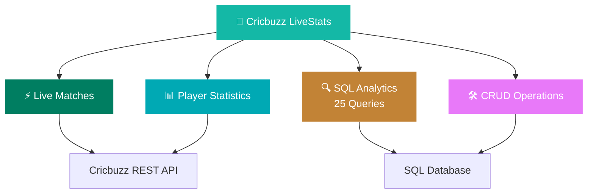
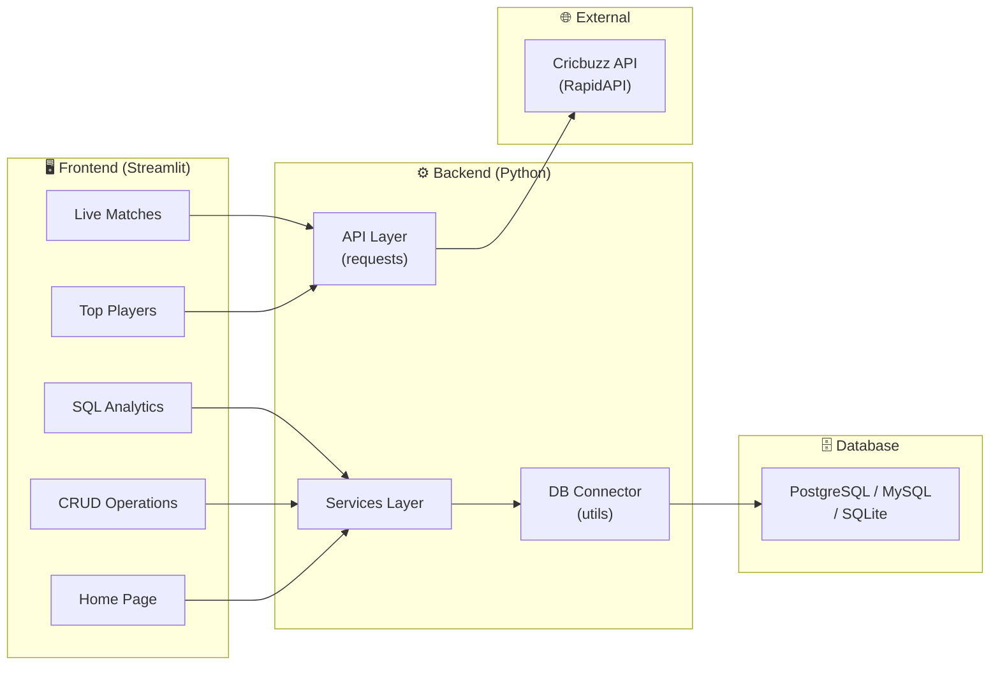
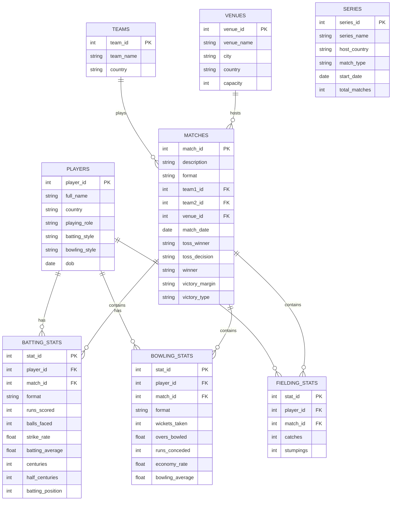

# 🏏 Cricbuzz LiveStats — Project Analysis & Plan

## 📁 Files in the Workspace

| File | Type | Purpose |
|------|------|---------|
| [`Cricbuzz.docx`](file:///c:/Users/punat/OneDrive%20-%20Vignan%20University/Desktop/Cricbuzz%20Project/Cricbuzz.docx) | Word Document (3.8 MB) | **Main project specification** — full requirements, problem statement, business use cases, 25 SQL questions, expected deliverables, and timeline |
| [`Prompt to be used in Claude.docx`](file:///c:/Users/punat/OneDrive%20-%20Vignan%20University/Desktop/Cricbuzz%20Project/Prompt%20to%20be%20used%20in%20Claude.docx) | Word Document (12 KB) | **Phased mentoring prompt** — an 18-phase learning roadmap to guide building the project step-by-step |
| [`Retail_Arcade.html`](file:///c:/Users/punat/OneDrive%20-%20Vignan%20University/Desktop/Cricbuzz%20Project/Retail_Arcade.html) | HTML (91 KB) | **Reference/sample project** — a self-contained retail analytics dashboard with gamification (arcade games, badges, charts). Likely a previous project or inspiration |

---

## 🎯 Project Summary

**Title:** Cricbuzz LiveStats: Real-Time Cricket Insights & SQL-Based Analytics

**Domain:** Sports Analytics

**Core Technologies:** Python • SQL • Streamlit • JSON • REST API

**Objective:** Build a comprehensive cricket analytics dashboard that integrates **live data from the Cricbuzz API** with a **SQL database** to create an interactive multi-page Streamlit web application.

### Four Pillars of the Application



---

## 📊 Business Use Cases

| # | Stakeholder | Use Case |
|---|------------|----------|
| 1 | 📺 Sports Media & Broadcasting | Real-time match updates for commentary, player analysis for pre-match discussions, historical trends for predictions |
| 2 | 🎮 Fantasy Cricket Platforms | Player form analysis, head-to-head statistics, real-time score updates |
| 3 | 📈 Cricket Analytics Firms | Advanced statistical modeling, performance trend analysis, data-driven insights for team management |
| 4 | 🎓 Educational Institutions | Teaching database operations with real-world data, SQL practice, API integration learning |
| 5 | 🎲 Sports Betting & Prediction | Historical performance analysis, player form tracking, venue-specific insights |

---

## 🏗️ Architecture Overview



---

## 📋 Deliverables Checklist

### Mandatory Features
| Status | Feature |
|--------|---------|
| ⬜ | API Integration (Cricbuzz via RapidAPI) |
| ⬜ | SQL Database (schema + tables + relationships) |
| ⬜ | CRUD Operations (Create, Read, Update, Delete) |
| ⬜ | Streamlit Dashboard (multi-page app) |
| ⬜ | SQL Analytics (25 queries — beginner to advanced) |
| ⬜ | Live Match Page (scorecards, match status, venue) |
| ⬜ | Top Player Stats Page (batting & bowling) |
| ⬜ | Home Page (project info, navigation) |
| ⬜ | Documentation (README, setup guide) |
| ⬜ | Recording Video (demo) |

### SQL Query Breakdown
| Level | Questions | Key Concepts |
|-------|-----------|-------------|
| **Beginner** (Q1–Q8) | 8 queries | `SELECT`, `WHERE`, `GROUP BY`, `ORDER BY`, aggregates |
| **Intermediate** (Q9–Q16) | 8 queries | `JOIN`, subqueries, `CASE`, conditional aggregation, cross-format comparison |
| **Advanced** (Q17–Q25) | 9 queries | Window functions, CTEs, standard deviation, time-series analysis, ranking systems |

---

## 🗂️ Recommended Project Structure

```
cricbuzz-project/
│
├── app.py                    # Main Streamlit entry point
├── config.py                 # API keys, DB credentials, constants
├── requirements.txt          # Python dependencies
├── README.md                 # Project documentation
│
├── database/
│   ├── schema.sql            # CREATE TABLE statements
│   ├── seed_data.sql         # Sample/initial data
│   └── indexes.sql           # Index definitions
│
├── api/
│   ├── cricbuzz_api.py       # API client wrapper
│   └── endpoints.py          # Endpoint constants
│
├── services/
│   ├── match_service.py      # Live match business logic
│   ├── player_service.py     # Player stats logic
│   └── analytics_service.py  # SQL analytics execution
│
├── pages/
│   ├── home.py               # Home page
│   ├── live_matches.py       # Live matches page
│   ├── top_players.py        # Top player stats page
│   ├── analytics.py          # SQL queries & analytics page
│   └── crud.py               # CRUD operations page
│
├── utils/
│   ├── db_connection.py      # Centralized DB connector
│   ├── helpers.py            # Formatting, validation
│   └── error_handler.py      # Exception handling
│
├── sql/
│   ├── beginner/             # Q1-Q8
│   ├── intermediate/         # Q9-Q16
│   └── advanced/             # Q17-Q25
│
├── assets/
│   └── logo.png, styles.css
│
├── tests/
│   ├── test_api.py
│   ├── test_db.py
│   └── test_crud.py
│
└── docs/
    ├── setup_guide.md
    └── api_reference.md
```

---

## 🗄️ Database Design (Key Entities)



---

## 🚀 Development Roadmap (8 Milestones)

### Milestone 1 — Environment Setup (Day 1–2)
- Install Python 3.10+, Streamlit, database connector
- Get Cricbuzz API key from RapidAPI
- Set up folder structure and `config.py`
- Create virtual environment and `requirements.txt`

### Milestone 2 — Database (Day 2–4)
- Design and create all tables (Players, Teams, Matches, Venues, Stats, Series)
- Define primary keys, foreign keys, indexes, constraints
- Insert sample/seed data
- Test with basic queries

### Milestone 3 — API Integration (Day 4–6)
- Build API client with `requests`
- Handle authentication (RapidAPI headers)
- Implement fetching: live matches, player stats, series info
- Add error handling, retry logic, rate limiting
- Parse JSON and map to database tables

### Milestone 4 — CRUD Operations (Day 6–8)
- Build Insert, Read, Update, Delete for players and matches
- Input validation and error handling
- Transaction management
- Streamlit form-based UI

### Milestone 5 — SQL Analytics (Day 8–11)
- Implement all 25 SQL queries (beginner → intermediate → advanced)
- Integrate queries into Streamlit with interactive display
- Add query explanations and results tables

### Milestone 6 — Streamlit Dashboard (Day 11–13)
- Build all 5 pages: Home, Live Matches, Top Players, Analytics, CRUD
- Add navigation, styling, and visualizations (charts, tables)
- Implement data visualizations (bar, line, pie charts)

### Milestone 7 — Testing & Polish (Day 13)
- Unit tests for API, DB, and CRUD modules
- Error handling review
- UI polish, responsive design
- Performance optimization (indexing, caching)

### Milestone 8 — Deployment & Documentation (Day 14)
- Write README and setup guide
- Record demo video
- Deploy (Streamlit Community Cloud / Render / Railway)

---

## 📝 About the Reference File (`Retail_Arcade.html`)

> [!NOTE]
> This is a **self-contained, single-file** retail analytics dashboard with 1,000 embedded transaction records. It features:
> - Interactive dashboard with KPIs, 6 SVG charts, sortable data table
> - Gamification: 4 arcade games (Higher/Lower, Price is Right, Spot the Odd Month, Build the Podium)
> - Progression system: XP, levels, streaks, coins, 8 achievement badges
> - Daily challenge with seeded questions
> - Advanced filtering (category, gender, age, quarter, price tier, month range)
> - Compare mode, export to CSV, random insight generator
> - Dark theme with glassmorphism, smooth animations, sound effects
>
> This appears to be a **past project or inspiration piece** — not directly related to the Cricbuzz project, but demonstrates the level of quality and interactivity that could be aimed for.

---

## 🔑 Key Technologies & Libraries

| Category | Technology |
|----------|-----------|
| **Language** | Python 3.10+ |
| **Web Framework** | Streamlit |
| **API** | Cricbuzz Cricket API (via RapidAPI) |
| **HTTP Client** | `requests` |
| **Database** | PostgreSQL / MySQL / SQLite |
| **DB Connector** | `mysql-connector-python` / `psycopg2` / `sqlite3` |
| **Data Processing** | `pandas` |
| **Visualization** | `plotly` / `matplotlib` / Streamlit native charts |
| **Version Control** | Git |

---

## ⏱️ Timeline

> [!IMPORTANT]
> The project must be completed within **14 days** from assignment date.

---

## 🎓 Learning Approach (from the Prompt Document)

The "Prompt to be used in Claude" document outlines an **18-phase mentored learning approach** where each phase must be completed before moving to the next:

| Phase | Focus |
|-------|-------|
| 1 | Project Understanding |
| 2 | Requirement Analysis |
| 3 | System Design |
| 4 | Database Design |
| 5 | API Analysis |
| 6 | Project Structure |
| 7 | Implementation Plan |
| 8 | Database Implementation |
| 9 | API Implementation |
| 10 | CRUD Module |
| 11 | SQL Analytics (one question at a time) |
| 12 | Streamlit Development |
| 13 | Visualization |
| 14 | Error Handling |
| 15 | Testing |
| 16 | Deployment |
| 17 | Documentation |
| 18 | Interview Preparation (50 questions) |

---

## ❓ Key Decisions Needed Before Starting

1. **Which database?** — SQLite (simplest), MySQL, or PostgreSQL?
2. **API Key** — Do you already have a Cricbuzz API key from RapidAPI?
3. **Deployment target** — Streamlit Cloud, Render, Railway, or local only?
4. **Approach** — Follow the 18-phase mentored learning path, or build directly?
